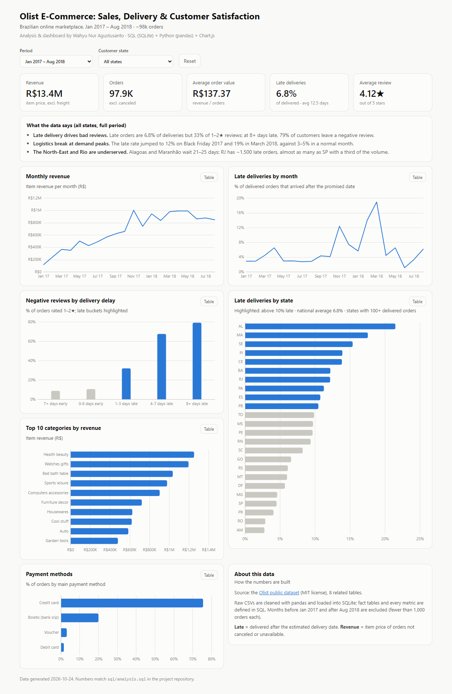

# Olist E-Commerce Analysis: Sales, Delivery & Customer Satisfaction

End-to-end data analysis of ~100k orders from Olist, a Brazilian online marketplace: data cleaning in
**Python**, data modeling and business questions in **SQL**, exploratory analysis and a simple
**predictive model** in a Jupyter notebook, and an **interactive dashboard**.

**Author:** Wahyu Nur Agustusanto · [wahyunur.runs-on.dev](https://wahyunur.runs-on.dev/) · [GitHub](https://github.com/Waynra)

**🔗 Live dashboard: [waynra.github.io/olist-ecommerce-analysis/dashboard](https://waynra.github.io/olist-ecommerce-analysis/dashboard/)**

[](https://waynra.github.io/olist-ecommerce-analysis/dashboard/)

## Key findings

| | Finding |
|---|---|
| 🚚 | **Late delivery is the #1 driver of bad reviews.** Late orders are 6.8% of deliveries but 33% of all 1–2★ reviews. At 8+ days late, 79% of customers leave a negative review (avg 1.7★ vs 4.3★ on time). |
| 📈 | **Revenue grew +138% year over year** (Jan–Aug 2018 vs 2017) to ~R$1M per month, but **logistics broke at demand peaks**: the late rate hit 12% on Black Friday 2017 and 19% in March 2018 (normal: 3–5%). |
| 🗺️ | **The North-East and Rio de Janeiro are underserved.** Alagoas and Maranhão wait 21–25 days and pay freight worth 20–26% of the item price. RJ has ~1,500 late orders, almost as many as São Paulo with a third of the volume. |
| 💳 | **Installments go with bigger baskets.** Credit card is 75% of orders; orders split into 7+ installments average R$335, 3.3× orders paid in full. |
| 🔁 | **Only 3% of customers buy again**, so growth depends almost entirely on new customers. |
| 🤖 | **A simple risk model (ROC AUC 0.74)** flags the 10% riskiest delivered orders, which contain 40% of all negative reviews, so customer service can contact them first. |

Full analysis with charts and recommendations: [`notebooks/olist_analysis.ipynb`](notebooks/olist_analysis.ipynb)

## Recommendations

1. Track the weekly late-delivery rate as a core KPI, with an alert above 8%.
2. Plan carrier capacity before November and Q1; widen promised delivery dates during peaks.
3. Add carrier partners or a regional hub for the North-East; investigate the RJ last-mile carrier.
4. Tell customers up front when a multi-seller order ships in separate packages (47% negative reviews vs 12%).
5. Promote interest-free installments on high-ticket categories.
6. Use the risk score to prioritise proactive customer-service contact.

## How it works

```
8 raw CSV files ──► pandas cleaning ──► SQLite tables ──► SQL transform ──► fact tables
 (data/raw/)        (build_database.py)   (schema.sql)     (transform.sql)   fact_orders, fact_order_items
                                                                                 │
                       ┌─────────────────────────────────────────────────────────┤
                       ▼                              ▼                          ▼
              business questions               notebook (EDA,              dashboard aggregates
              (analysis.sql)                   charts, model)              (dashboard.sql → data.js)
```

**SQL techniques used:** CTEs, window functions (`LAG`, `ROW_NUMBER`, running `SUM() OVER`),
conditional aggregation, `CASE` bucketing, date arithmetic, multi-table joins, data-quality checks.

### Data cleaning

All steps are logged in [`reports/data_cleaning_log.md`](reports/data_cleaning_log.md). Highlights:

| Issue | Fix |
|---|---|
| 551 orders with more than one review | Kept the latest review per order |
| 610 products without a category; 2 categories without an English name | `unknown` / kept the Portuguese name |
| Misspelled columns (`product_name_lenght`) | Renamed |
| 6 non-delivered orders with a delivery date | Delivery date removed so they don't count as delivered |
| 3 payments with type `not_defined`, 2 with 0 installments | Removed / set to 1 |
| Months with < 1,000 orders (2016, Sep–Oct 2018) | Excluded: analysis window is Jan 2017 – Aug 2018 |
| `customer_id` changes on every order | Retention uses `customer_unique_id` |

### Predictive model

Logistic regression predicting a 1–2★ review for delivered orders, using only information known at delivery
time (delivery days, delay vs the promised date, number of items, multi-seller order, order value, freight
ratio, installments). Balanced class weights, 75/25 stratified split.

| Metric | Value |
|---|---|
| ROC AUC (model) | 0.74 |
| ROC AUC ("was it late?" only) | 0.65 |
| Negative-review rate in the top 10% riskiest orders | 51% (base rate 13%) |
| Share of all negative reviews caught in that top 10% | 40% |

Limitations: product quality, seller history, and review text are not in the model.

## Project structure

```
olist-ecommerce-analysis/
├── data/
│   ├── raw/                  # downloaded CSVs (not committed)
│   └── olist.db              # SQLite database (generated, not committed)
├── sql/
│   ├── schema.sql            # tables, keys, indexes
│   ├── transform.sql         # analysis-ready fact tables
│   ├── analysis.sql          # 10 business questions + data-quality checks
│   └── dashboard.sql         # aggregates for the dashboard
├── src/
│   ├── download_data.py      # get the dataset
│   ├── build_database.py     # clean with pandas, load into SQLite, run transform.sql
│   ├── queries.py            # run named SQL queries from Python
│   └── export_dashboard_data.py
├── notebooks/
│   └── olist_analysis.ipynb  # EDA, charts, model, recommendations
├── dashboard/
│   ├── index.html            # interactive dashboard (Chart.js)
│   └── data.js               # generated data for the dashboard
└── reports/
    ├── data_cleaning_log.md
    ├── figures/              # charts used in the notebook and README
    └── sql_results/          # CSV output of every query in analysis.sql
```

## Run it yourself

Requires Python 3.10+.

```bash
git clone https://github.com/Waynra/olist-ecommerce-analysis.git
cd olist-ecommerce-analysis
python -m venv .venv
.venv\Scripts\activate          # macOS/Linux: source .venv/bin/activate
pip install -r requirements.txt

python src/download_data.py         # ~60 MB from github.com/olist/work-at-olist-data
python src/build_database.py        # clean + load into data/olist.db
python src/queries.py               # run every SQL question, save to reports/sql_results/
python src/export_dashboard_data.py # refresh dashboard/data.js

jupyter notebook notebooks/olist_analysis.ipynb
python -m http.server 8000 --directory dashboard   # open http://localhost:8000
```

## Data

[Olist public e-commerce dataset](https://github.com/olist/work-at-olist-data), MIT license.
Revenue figures are in Brazilian reais (R$) and count item prices of orders that were not canceled or
unavailable; freight is reported separately.
